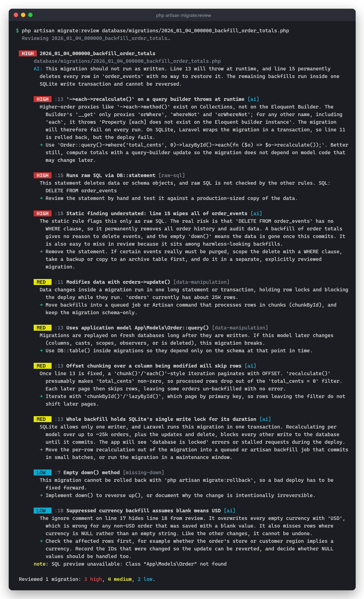
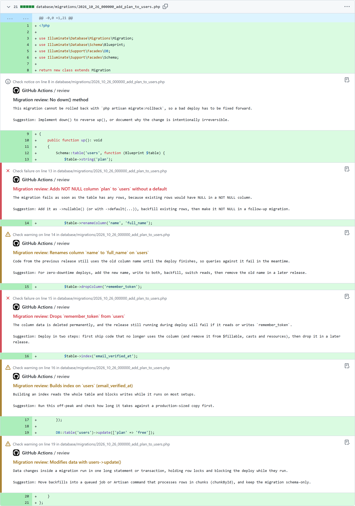

# Laravel Migration Review

[](https://github.com/GodfreysDragon/laravel-migration-review/actions/workflows/tests.yml)
[](https://packagist.org/packages/godfreysdragon/laravel-migration-review)
[](LICENSE.md)

**Catch dangerous migrations before they reach production.**

`php artisan migrate:review` checks your pending migrations for the changes that cause outages and data loss: dropped columns, NOT NULL columns that fail on existing rows, index builds that lock big tables, renames that break the release still running mid-deploy, backfills hiding in `up()`. It runs as a fast static rule engine with no database writes and no API key. Add an Anthropic key and Claude reviews each migration too, with the SQL, your table sizes and the rule findings as context.

Real output for one of the test fixtures, run against a SQLite database where `orders` already has 1,500 rows:

```text
$ php artisan migrate:review database/migrations/2026_01_02_000000_add_status_to_orders_table.php --no-ai

  HIGH  2026_01_02_000000_add_status_to_orders_table
      database/migrations/2026_01_02_000000_add_status_to_orders_table.php

       HIGH  :12 Adds NOT NULL column `status` to `orders` without a default [not-null-without-default]
        The migration fails as soon as the table has any rows, because existing rows would have NULL in a NOT NULL column. `orders` currently has about 1.5K rows.
        → Add it as ->nullable() (or with ->default(...)), backfill existing rows, then make it NOT NULL in a follow-up migration.

       MED   :15 Builds index on `orders` (customer_email) [index-on-existing-table]
        Building an index reads the whole table and blocks writes while it runs on most setups. `orders` currently has about 1.5K rows.
        → Run this off-peak and check how long it takes against a production-sized copy first.

 Reviewed 1 migration: 1 high, 1 medium, 0 low.
```

On PostgreSQL or MySQL the index advice is engine-specific (`CREATE INDEX CONCURRENTLY`, `ALGORITHM=INPLACE`). Above `large_table_rows` (1M by default) the index finding moves up to high.

### With the AI review

With an Anthropic API key set, Claude adds a one-line `AI:` summary under each file name, plus its own findings tagged `[ai]`. Here is a real run (Claude Opus 5.5, effort `medium`) on this backfill fixture, in a fresh Laravel 13 app on SQLite with 25,000 rows in `orders`:

```php
public function up(): void
{
    DB::table('orders')->whereNull('status')->update(['status' => 'pending']);

    Order::query()->where('total_cents', 0)->each->recalculate();

    DB::statement('DELETE FROM order_events');

    // migration-review-ignore: data-manipulation
    DB::table('orders')->where('currency', '')->update(['currency' => 'USD']);
}

public function down(): void {}
```



<details>
<summary>Same output as text</summary>

```text
$ php artisan migrate:review        # excerpt: one of the three pending migrations

  HIGH  2026_01_04_000000_backfill_order_totals
      database/migrations/2026_01_04_000000_backfill_order_totals.php
      AI: This migration should not run as written. Line 13 will throw at runtime, and line 15 permanently deletes every row in `order_events` with no way to restore it. The remaining backfills run inside one SQLite write transaction and cannot be reversed.

       HIGH  :13 `->each->recalculate()` on a query builder throws at runtime [ai]
        Higher-order proxies like `->each->method()` exist on Collections, not on the Eloquent Builder. The Builder's `__get` only proxies `orWhere`, `whereNot` and `orWhereNot`; for any other name, including `each`, it throws `Property [each] does not exist on the Eloquent builder instance`. The migration will therefore fail on every run. On SQLite, Laravel wraps the migration in a transaction, so line 11 is rolled back, but the deploy fails.
        → Use `Order::query()->where('total_cents', 0)->lazyById()->each(fn ($o) => $o->recalculate());`. Better still, compute totals with a query-builder update so the migration does not depend on model code that may change later.

       HIGH  :15 Runs raw SQL via DB::statement [raw-sql]
        This statement deletes data or schema objects, and raw SQL is not checked by the other rules. SQL: DELETE FROM order_events
        → Review the statement by hand and test it against a production-sized copy of the data.

       HIGH  :15 Static finding understated: line 15 wipes all of order_events [ai]
        The static rule flags this only as raw SQL. The real risk is that `DELETE FROM order_events` has no WHERE clause, so it permanently removes all order history and audit data. A backfill of order totals gives no reason to delete events, and the empty `down()` means the data is gone once this commits. It is also easy to miss in review because it sits among harmless-looking backfills.
        → Remove the statement. If certain events really must be purged, scope the delete with a WHERE clause, take a backup or copy to an archive table first, and do it in a separate, explicitly reviewed migration.

       MED   :11 Modifies data with orders->update() [data-manipulation]
        Data changes inside a migration run in one long statement or transaction, holding row locks and blocking the deploy while they run. `orders` currently has about 25K rows.
        → Move backfills into a queued job or Artisan command that processes rows in chunks (chunkById), and keep the migration schema-only.

       MED   :13 Uses application model App\Models\Order::query() [data-manipulation]
        Migrations are replayed on fresh databases long after they are written. If this model later changes (columns, casts, scopes, observers, or is deleted), this migration breaks.
        → Use DB::table() inside migrations so they depend only on the schema at that point in time.

       MED   :13 Offset chunking over a column being modified will skip rows [ai]
        Once line 13 is fixed, a `chunk()`/`each()`-style iteration paginates with OFFSET. `recalculate()` presumably makes `total_cents` non-zero, so processed rows drop out of the `total_cents = 0` filter. Each later page then skips rows, leaving some orders un-backfilled with no error.
        → Iterate with `chunkById()`/`lazyById()`, which page by primary key, so rows leaving the filter do not shift later pages.

       MED   :13 Whole backfill holds SQLite's single write lock for its duration [ai]
        SQLite allows only one writer, and Laravel runs this migration in one transaction. Recalculating per model over up to ~25k orders, plus the updates and delete, blocks every other write to the database until it commits. The app will see `database is locked` errors or stalled requests during the deploy.
        → Move the per-row recalculation out of the migration into a queued or artisan backfill job that commits in small batches, or run the migration in a maintenance window.

       LOW   :7 Empty down() method [missing-down]
        This migration cannot be rolled back with `php artisan migrate:rollback`, so a bad deploy has to be fixed forward.
        → Implement down() to reverse up(), or document why the change is intentionally irreversible.

       LOW   :18 Suppressed currency backfill assumes blank means USD [ai]
        The ignore comment on line 17 hides line 18 from review. It overwrites every empty currency with 'USD', which is wrong for any non-USD order that was saved with a blank value. It also misses rows where currency is NULL rather than an empty string. Like the other changes, it cannot be undone.
        → Check the affected rows first, for example whether the order's store or customer region implies a currency. Record the IDs that were changed so the update can be reverted, and decide whether NULL values should be handled too.
      note: SQL preview unavailable: Class "App\Models\Order" not found
```

</details>

The rules flag the shape of each risky operation. Claude catches what needs judgement: line 13 can never run, the raw `DELETE` is worse than a generic raw-SQL warning, and the line hidden by the ignore comment is still wrong. AI output varies between runs; reviews are cached, so re-running on an unchanged migration returns the same result.

## Why

`migrate` does exactly what you wrote, against however many rows production has. Code review often misses migration risks, because they depend on things the diff doesn't show:

- **How big the table is.** An index on a 2,000-row table is instant. On 40M rows it locks writes for minutes.
- **What the old code is doing during the deploy.** Renaming or dropping a column breaks the release that is still serving traffic.
- **Engine quirks.** PostgreSQL rejects a NOT NULL column without a default on a non-empty table. MySQL accepts it and fills existing rows with zero values.
- **Laravel quirks.** Since Laravel 11, `->change()` silently drops `nullable`, `default` and `comment` unless you restate them.

This package checks for all of these on every pull request.

## Installation

```bash
composer require --dev godfreysdragon/laravel-migration-review
```

Requires PHP 8.2+ and Laravel 12 or 13. The service provider is auto-discovered.

To enable the AI review, add an [Anthropic API key](https://console.anthropic.com/) to `.env`:

```dotenv
ANTHROPIC_API_KEY=sk-ant-...
```

Optionally publish the config:

```bash
php artisan vendor:publish --tag=migration-review-config
```

## Usage

```bash
php artisan migrate:review                       # pending migrations (not yet run on this database)
php artisan migrate:review database/migrations/2026_01_02_000000_add_status.php
php artisan migrate:review --all                 # every migration
php artisan migrate:review --show-sql            # include the SQL each migration would run
php artisan migrate:review --no-ai               # static rules only
php artisan migrate:review --fail-on=high        # exit 1 if anything is high severity
php artisan migrate:review --format=json         # text (default), json, markdown, github
php artisan migrate:review --format=markdown --output=review.md
```

| Option | Description |
| --- | --- |
| `paths*` | Files or directories to review. Defaults to pending migrations. |
| `--all` | Review every migration, not only pending ones. |
| `--database=` | Connection used for the SQL preview, table sizes and the pending check. |
| `--format=` | `text`, `json`, `markdown` (PR comments) or `github` (inline annotations). |
| `--output=` | Also write the report to a file. |
| `--fail-on=` | `low`, `medium`, `high` or `none` (default from config: `none`). |
| `--no-ai` / `--no-sql` / `--no-stats` | Skip the AI review, the SQL preview, or the table-size lookup. |
| `--show-sql` | Print the SQL each migration would run (text format). |

### How it works

1. **Parse.** Each migration is parsed into an AST with [nikic/php-parser](https://github.com/nikic/PHP-Parser). The rules work on that AST alone, so they never run the migration and need no database.
2. **Context.** Row counts for the affected tables come from database statistics: `information_schema` on MySQL, `pg_class.reltuples` on PostgreSQL, `sys.partitions` on SQL Server, `COUNT(*)` on SQLite. The SQL each migration would run comes from calling `up()` in Laravel's `pretend` mode, which captures the queries on the migration's connection instead of running them. Everything else in `up()` still runs: see [Security](#security).
3. **Rules.** Each rule reports a severity, an explanation and a concrete fix. Lock-sensitive findings move up one severity level on tables above `large_table_rows`.
4. **AI review (optional).** Claude receives the numbered source, the SQL preview, the driver, the row counts and the rule findings. It reports only what the rules missed, or where a rule got it wrong. Responses use [structured outputs](https://platform.claude.com/docs/en/build-with-claude/structured-outputs), so they are always valid JSON.

## Rules

| Rule id | Catches | Default severity |
| --- | --- | --- |
| `drop-table` | `Schema::drop()` / `dropIfExists()` on existing tables | high |
| `drop-column` | `dropColumn`, `dropSoftDeletes`, `dropTimestamps`, `dropMorphs`, `Schema::dropColumns()`… | high |
| `not-null-without-default` | Adding a NOT NULL column with no default to an existing table (including `foreignId()->constrained()`) | high (medium on MySQL) |
| `rename` | `renameColumn`, `Schema::rename` (breaks the old release mid-deploy) | medium |
| `column-change` | `->change()`: table rewrites, truncation, and modifiers dropped since Laravel 11 | medium |
| `index-on-existing-table` | Indexes, uniques and foreign keys added to existing tables, with driver-specific online alternatives | medium |
| `data-manipulation` | `DB::table()->update()/delete()/truncate()` backfills and Eloquent models used inside migrations | medium (truncate: high) |
| `raw-sql` | `DB::statement()` / `DB::unprepared()`. Destructive SQL is high; SQL that only touches tables created in this run is low | medium |
| `missing-down` | Missing or empty `down()` | low |

Operations on a table created **in the same migration**, or by an earlier migration in the same run that has not been applied yet, are not flagged, because that table has no rows yet. (`column-change` is the exception: since Laravel 11, `->change()` drops modifiers you don't restate, even on an empty table.)

### Silencing a finding

Add a comment on the line, or the line above:

```php
// migration-review-ignore: drop-column
$table->dropColumn('legacy_flag');

// migration-review-ignore: drop-table -- archived in the Q3 cleanup   ← anything after the ids is a free-form reason

// migration-review-ignore        ← ignores every rule for the next line
```

Disable a rule globally with `disabled_rules` in `config/migration-review.php`.

### Custom rules

Implement `GodfreysDragon\MigrationReview\Analysis\Rules\Rule` (or extend `BaseRule`) and add the class to `rules` in the config:

```php
use GodfreysDragon\MigrationReview\Analysis\RuleContext;
use GodfreysDragon\MigrationReview\Analysis\Rules\BaseRule;
use GodfreysDragon\MigrationReview\Analysis\Severity;
use GodfreysDragon\MigrationReview\Support\Parsed\ParsedMigration;

class NoEnumColumnsRule extends BaseRule
{
    public function id(): string
    {
        return 'no-enum';
    }

    public function check(ParsedMigration $migration, RuleContext $context): array
    {
        $findings = [];

        foreach ($migration->operations as $operation) {
            foreach ($operation->blueprintCalls as $call) {
                if ($call->method() === 'enum') {
                    $findings[] = $this->finding(Severity::Low, 'Enum column', 'Adding values to an enum later rewrites the table.', $call->line);
                }
            }
        }

        return $findings;
    }
}
```

## Continuous integration

### GitHub Actions: inline annotations on the PR

With `--format=github`, each finding appears on its line in the PR's **Files changed** tab. This is a real run from the [demo repository](https://github.com/GodfreysDragon/laravel-migration-review-demo) ([PR #2](https://github.com/GodfreysDragon/laravel-migration-review-demo/pull/2)), using the workflow below with the changed-files step ([full file](https://github.com/GodfreysDragon/laravel-migration-review-demo/blob/main/.github/workflows/migration-review.yml)):



High findings are errors, medium are warnings and low are notices. With `--fail-on=high` the check fails, so the PR can't merge while branch protection requires it.

```yaml
# .github/workflows/migration-review.yml
name: Migration review

on:
  pull_request:
    paths: ['database/migrations/**']

permissions:
  contents: read

jobs:
  review:
    runs-on: ubuntu-latest
    steps:
      - uses: actions/checkout@v7
      - uses: shivammathur/setup-php@v2
        with:
          php-version: '8.4'
      - run: composer install --no-interaction --prefer-dist
      - run: cp .env.example .env && php artisan key:generate
      - name: Review migrations
        env:
          ANTHROPIC_API_KEY: ${{ secrets.ANTHROPIC_API_KEY }}
        run: php artisan migrate:review --all --format=github --fail-on=high
```

On a fresh CI database every migration counts as pending, so to review only the files a PR touches, pass them explicitly:

```yaml
      - name: Review changed migrations
        run: |
          FILES=$(git diff --name-only --diff-filter=AM origin/${{ github.base_ref }}... -- database/migrations)
          [ -z "$FILES" ] || php artisan migrate:review $FILES --format=github --fail-on=high
```

(Use `actions/checkout` with `fetch-depth: 0` so the base branch is available.)

Keep the `pull_request` trigger. The SQL preview runs the PR's `up()` code, and `pull_request` doesn't give secrets to PRs from forks. Never switch to `pull_request_target` to get the API key into fork PRs: that runs untrusted code with your secrets. See [Security](#security).

### PR comment

`--format=markdown --output=migration-review.md` writes a table you can post with any "comment on PR" action.

### Against production statistics

Severity escalation only works when row counts are known. Run the command with `--database=` pointing at a read replica (or a production-sized staging copy) to get them. The lookups are read-only queries against catalog tables. Add `--no-sql` here unless you trust every migration being reviewed, since the SQL preview runs `up()` with the app's access to that environment.

## The AI review

| | |
| --- | --- |
| **Model** | `claude-opus-5-5` by default (`MIGRATION_REVIEW_MODEL`), effort `medium` (`MIGRATION_REVIEW_EFFORT`). |
| **What is sent** | The migration file, its SQL preview with bound values replaced by `?`, the database driver, row counts of affected tables, and the rule findings. No data rows, credentials or other source files. Bound values are left out because they can be computed at runtime, for example from `config()` or `env()`; the local report still shows them. |
| **Cost** | Usually a few thousand input tokens per migration, roughly a few cents. Reviews are cached by a hash of everything sent (30 days by default), so re-running CI on an unchanged migration is free. |
| **Failure handling** | Rate limits, auth errors, refusals and malformed replies become a `note:` on the report. The static findings are still reported and the exit code is unaffected. Server-side fallbacks are enabled, so a request the model declines is retried on another model. |
| **Prompt injection** | Migration source is passed as delimited data that can't close its own section, and the model is told to ignore instructions inside it. The model can only add findings: it can't remove or lower the rule findings, so it can't make a failing check pass. |

Turn it off with `MIGRATION_REVIEW_AI=false` or `--no-ai`.

## Configuration

```php
// config/migration-review.php
return [
    'ai' => [
        'enabled' => env('MIGRATION_REVIEW_AI', true),
        'api_key' => env('ANTHROPIC_API_KEY'),
        'model' => env('MIGRATION_REVIEW_MODEL', 'claude-opus-5-5'),
        'effort' => env('MIGRATION_REVIEW_EFFORT', 'medium'),
        'cache' => ['enabled' => true, 'store' => null, 'ttl' => 60 * 60 * 24 * 30],
    ],
    'large_table_rows' => 1_000_000,   // escalate lock-sensitive findings above this
    'table_stats' => true,
    'sql_preview' => env('MIGRATION_REVIEW_SQL_PREVIEW', true),   // runs up() in pretend mode; see Security
    'fail_on' => env('MIGRATION_REVIEW_FAIL_ON', 'none'),
    'rules' => [/* ... */],
    'disabled_rules' => [],
];
```

## Limitations

- The rules detect operations written with the schema builder and `DB` facade. Migrations that build table names dynamically or hide logic in helper classes get less precise results, and the AI review is the safety net there.
- The SQL preview runs `up()` in pretend mode. Migrations that read data or call application code may not preview, which is reported as a note.
- Row counts are estimates from database statistics. They are accurate enough for "is this table big?", but not exact.

## Security

**The static rules never run migration code.** They read the file's syntax tree only.

**The SQL preview does run it.** To show the SQL, the command loads each migration and calls `up()` inside Laravel's `pretend` mode, the same mechanism as `php artisan migrate --pretend`. Pretend mode captures queries on the migration's own connection instead of running them. Everything else in `up()` runs normally, with your app's full access: file writes, HTTP calls, queries on any other connection, and reads of environment variables such as `ANTHROPIC_API_KEY`. In practice:

- Reviewing a migration is as trusting as running it, or running the tests of the PR that adds it. Don't review code you wouldn't run.
- For code you don't trust, turn the preview off with `--no-sql` or `MIGRATION_REVIEW_SQL_PREVIEW=false`. The static rules and the AI review still work without it.
- In GitHub Actions, use the `pull_request` trigger, which gives no secrets to PRs from forks, and never `pull_request_target`.

**What leaves your machine.** Only the AI review sends anything, and only when an API key is set. Bound values in the SQL are replaced by `?` first. See [what is sent](#the-ai-review). Locally, `--show-sql` and the JSON report do include the real values, so treat CI logs and report files like any other output of your app.

**Output.** Report text can come from migration source, error messages or the AI, so it's escaped for each format: control characters are stripped everywhere, the Markdown format neutralizes links, images, HTML and `@mentions` before you post it as a PR comment, and GitHub annotations are encoded as workflow command data.

Please report vulnerabilities privately through [GitHub security advisories](https://github.com/GodfreysDragon/laravel-migration-review/security/advisories/new), not in a public issue.

## Development

```bash
composer install
composer test      # PHPUnit; no network calls (the Anthropic SDK runs against a stubbed transport)
composer format    # Laravel Pint
composer analyse   # PHPStan (Larastan)
```

The default suite uses in-memory SQLite. To also run the driver tests against a real MySQL or PostgreSQL server (CI runs both), set the connection in the environment:

```bash
TEST_DB_DRIVER=pgsql DB_PORT=5432 DB_USERNAME=postgres DB_PASSWORD=secret vendor/bin/phpunit --filter DatabaseDriversTest
```

Contributions are welcome, especially new rules with tests. Each rule lives in `src/Analysis/Rules` and is tested in `tests/Unit/RulesTest.php`.

## License

MIT. See [LICENSE.md](LICENSE.md).
